<a href="https://leonardolees.com">
  
</a>

  
  
  
  

 

<picture>
  <source media="(prefers-color-scheme: dark)" srcset="assets/headings/about-dark.svg">
  <source media="(prefers-color-scheme: light)" srcset="assets/headings/about-light.svg">
  
</picture>

Hey, I'm Leo, a Canadian-American, self-taught developer who's been writing code for just over six years. I love building things that are fast, efficient, and secure, from web apps all the way down to low-level protocols and the hardware they run on.

- **Recent work:** off-grid, end-to-end encrypted messaging on ESP32 + LoRa with [Carrier Pigeon](https://github.com/LeoL6/carrier-pigeon)
- **Speaking:** ATLSECCON 2025 & 2026 and BSides Halifax 2025
- **Hackathons:** NASA Space Apps 2025 with the [Sceptre Weather Dashboard](https://github.com/LeoL6/Sceptre-Weather-Dashboard)
- **Background:** born in Arizona, now based in Canada 🇨🇦

 

<picture>
  <source media="(prefers-color-scheme: dark)" srcset="assets/headings/stack-dark.svg">
  <source media="(prefers-color-scheme: light)" srcset="assets/headings/stack-light.svg">
  
</picture>

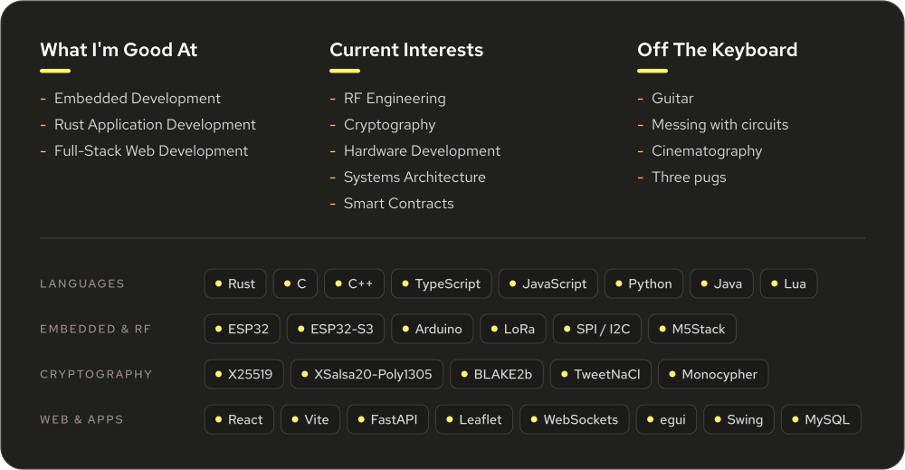

 

<picture>
  <source media="(prefers-color-scheme: dark)" srcset="assets/headings/projects-dark.svg">
  <source media="(prefers-color-scheme: light)" srcset="assets/headings/projects-light.svg">
  
</picture>

  <a href="https://github.com/LeoL6/carrier-pigeon">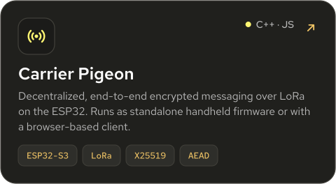</a>
  <a href="https://github.com/LeoL6/Phisher">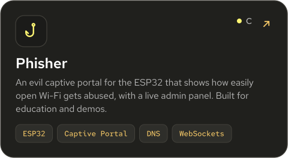</a>

  <a href="https://github.com/LeoL6/triangle-gator">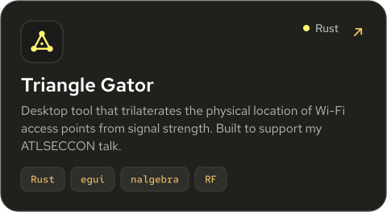</a>
  <a href="https://github.com/LeoL6/Sceptre-Weather-Dashboard">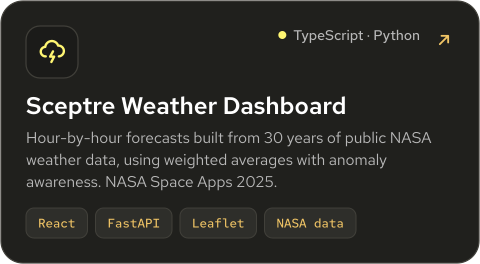</a>

  <a href="https://github.com/LeoL6/Obj-Renderer">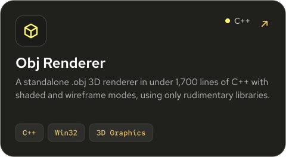</a>
  <a href="https://github.com/LeoL6/Roblox-Admin-Panel">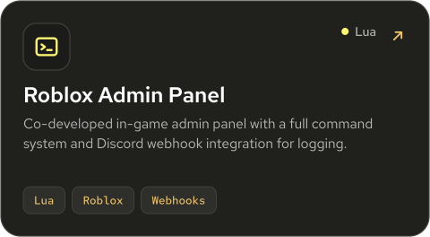</a>

Also worth a look: Carrier Pigeon's [standalone handheld build](https://github.com/LeoL6/carrier-pigeon/tree/standalone) (Heltec LoRa V3.2, 3.7" display, CardKB) and a [Java desktop login app](https://github.com/LeoL6/minecraft-cheat-installer) built with Swing, MySQL, and BCrypt.

 

<picture>
  <source media="(prefers-color-scheme: dark)" srcset="assets/headings/talks-dark.svg">
  <source media="(prefers-color-scheme: light)" srcset="assets/headings/talks-light.svg">
  
</picture>

  <a href="https://www.youtube.com/watch?v=LALLvagZHvY">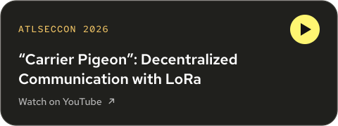</a>
  <a href="https://www.youtube.com/watch?v=MCNPLVsqKd4">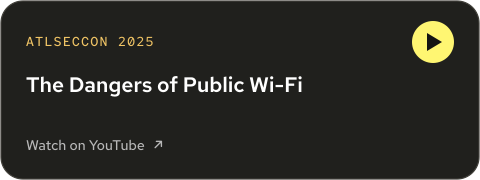</a>

  <a href="https://www.youtube.com/watch?v=Z-nqv3l5RT0">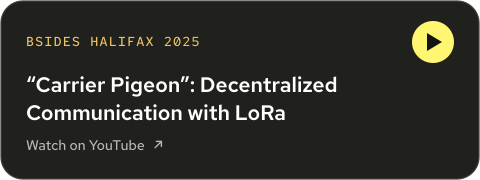</a>
  <a href="https://www.youtube.com/watch?v=gALW2CJMU1c">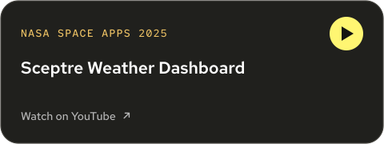</a>

 

<picture>
  <source media="(prefers-color-scheme: dark)" srcset="assets/headings/contact-dark.svg">
  <source media="(prefers-color-scheme: light)" srcset="assets/headings/contact-light.svg">
  
</picture>

The best way to reach me is email at **[contact@leonardolees.com](mailto:contact@leonardolees.com)**. I'm always happy to talk embedded systems, RF, cryptography, or whatever you're building. You can find more of my work at **[leonardolees.com](https://leonardolees.com)**.

<!-- SVG assets are generated by scripts/build_assets.py. Edit the CONTENT section there and re-run it. -->
